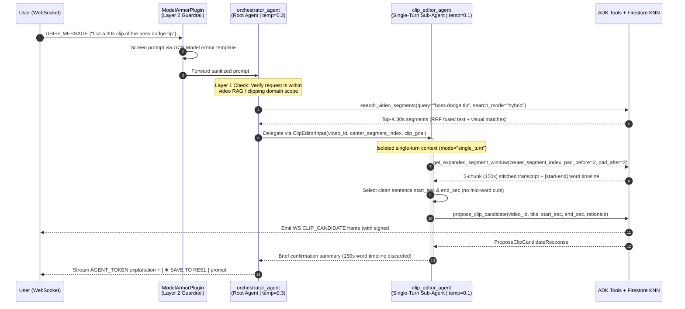
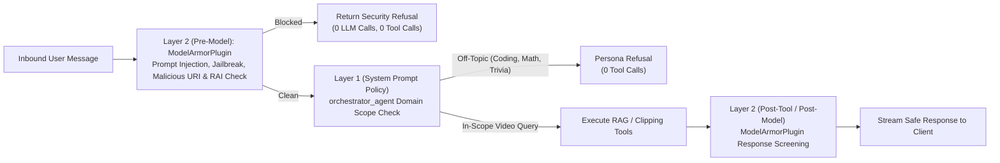

# CLIP_AGENT_OS System Architecture & ADRs (`docs/architecture.md`)

This document details the end-to-end system architecture, Google ADK 2.0 multi-agent topology, multimodal RAG & video-processing pipelines, security guardrails, data schemas, and Architecture Decision Records (ADRs) for **CLIP_AGENT_OS** (`capstone_be`).

> **Related Reference Documents**:
> - **Project Scope**: `requirement_docs/clipper_agent_docs/custom_scope/clipper_agent_scoping.pdf`
> - **Technical Design Document (TDD)**: `requirement_docs/clipper_agent_docs/custom_tdd/clipper_agent_tdd.pdf`
> - **Visual Architecture Diagram**: `requirement_docs/clipper_agent_docs/capstone_arch_diagram.png`
> - **Infrastructure-as-Code**: `terraform/main.tf`, `terraform/variables.tf`, `terraform/outputs.tf`

---

## 1. Executive Summary & Architecture Principles

**CLIP_AGENT_OS** is a conversational, agentic **Long-Form-to-Short-Form Video Clipping & Multimodal RAG Studio** engineered for **StreamersUnited Management Company** inside a 100% self-contained Google Cloud (Argolis) sandbox. It replaces manual timeline scrubbing and multi-track video editing with asynchronous multimodal indexing, natural-language hybrid vector search, precision AI clip boundary cutting, interactive word-level subtitle refinement, and on-demand vertical/landscape MP4 rendering.

### Core Architecture Principles

| Principle | Architectural Implementation |
| :--- | :--- |
| **1. Responsive UX** | Decouples heavy video ingestion and transcoding from the FastAPI server using direct-to-GCS v4 Signed URLs, asynchronous Cloud Run Jobs, bidirectional WebSocket streaming (`WS /api/chat/stream`), live mid-turn `INTERRUPT` / `ADD_CONTEXT` controls, and instant `#t=start,end` media-fragment clip previews. |
| **2. Modularity & Model Swappability** | Separates conversational RAG orchestration (`orchestrator_agent`) from precision timestamp cutting (`clip_editor_agent`), equips them with four discrete tools, and externalizes all model identifiers (`ORCHESTRATOR_MODEL_NAME`, `CLIPPER_SUBAGENT_MODEL_NAME`, `EMBEDDING_MODEL_NAME`) into environment variables and Terraform variables. |
| **3. Modular Parallel Ingestion** | Executes long-form video indexing in an isolated `capstone-video-processor` Cloud Run Job that runs FFmpeg `16kHz` audio extraction + 6-way parallel Cloud Speech-to-Text V2 (`long`) concurrently with 8-way parallel 30-second multimodal `gemini-embedding-2` (`1408d`) indexing. |
| **4. Token & Compute Cost Optimization** | Keeps system prompts and tool signatures 100% static across turns (reading `uid` and `selected_video_ids` from `ToolContext`) to maximize Gemini prefix cache hits; isolates 150-second word-timestamp windows inside `clip_editor_agent` (`mode="single_turn"`); and defers FFmpeg rendering via `PENDING_CUT` state and `rendered_variants` caching. |
| **5. Agentic Observability & Evaluation** | Exports OpenTelemetry spans to Google Cloud Trace (`CloudTraceSpanExporter`), correlates structured JSON logs (`logging.googleapis.com/trace`), streams live reasoning and tool traces to the UI's `AGENT TRACE` drawer, and validates North Star KPIs via an automated evaluation suite (`evals/`). |

---

## 2. End-to-End Studio Workflows

The platform is organized around four cohesive studio workflows connecting the React frontend (`capstone-fe`), the FastAPI + ADK 2.0 backend (`capstone_be`), and the asynchronous video processor (`capstone_video_processor`):

### 2.1 `UPLOAD` Workflow — Direct-to-GCS Ingestion & Parallel Multimodal Indexing
1. **Upload Initialization (`POST /api/lf_videos/upload/init`)**:
   - Validates the video MIME type (`video/mp4`, `video/quicktime`, `video/webm`, `video/x-matroska`) and creates an `lfvideos` tracking document in Firestore (`status = "UPLOADING"`, `is_complete = False`).
   - Generates a **GCS v4 Signed `PUT` URL** (`120`-minute expiration) scoped to `<uid>/lf_videos/<video_id>/<sanitized_filename>`.
2. **Direct Browser-to-GCS Transfer**:
   - The React client uploads the raw binary directly to GCS with real-time progress reporting, completely bypassing FastAPI memory and Cloud Run request payload limits.
   - If the transfer fails, `POST /api/lf_videos/upload/{vid}/failed` marks the document `FAILED`.
3. **Completion & Job Dispatch (`POST /api/lf_videos/upload/{vid}/complete`)**:
   - Verifies the object exists in GCS, transitions the `lfvideos` document to `status = "PROCESSING"`, and triggers `capstone-video-processor` via `google.cloud.run_v2.JobsClient.run_job` passing `--video-id <vid> --uid <uid>`.
4. **Parallel Cloud Run Job Execution (`capstone_video_processor/main.py`)**:
   - **Branch A — Word-Level Audio Transcription (`utils/audio_transcriber.py`)**:
     - Checks GCS for an existing `transcript_checkpoint.json` to make retries idempotent.
     - Extracts a `16kHz` mono FLAC stream via FFmpeg's `segment` muxer (`-segment_time 600`), splitting multi-hour recordings into 10-minute audio chunks and recording exact start offsets in `segments.csv`.
     - Uploads chunks to `<uid>/lf_videos/<video_id>/temp_audio_chunks/` and executes up to **6 concurrent** Cloud Speech-to-Text V2 `BatchRecognize` jobs (`model="long"`, `enable_word_time_offsets=True`, `enable_automatic_punctuation=True`).
     - Shifts every word's protobuf `start_offset` and `end_offset` by the exact FFmpeg `chunk_start_sec`, saves `transcript_checkpoint.json`, and cleans up temporary FLAC blobs in a `finally` block.
   - **Branch B — 30-Second Multimodal Embedding (`utils/video_embedder.py`)**:
     - Runs **concurrently** with Branch A via `ThreadPoolExecutor`.
     - Divides the video duration into consecutive 30-second windows (`segment_index = 0, 1, 2, ...`).
     - Uses **8 parallel workers** (`MAX_EMBED_WORKERS = 8`) to call Vertex AI's `gemini-embedding-2` (`output_dimensionality = 1408`) directly on the GCS URI using `types.VideoMetadata(start_offset=..., end_offset=...)`—generating `video_embedding` vectors without physically slicing or re-uploading MP4 chunks.
     - Once Branch A finishes, aligns the spoken `words` array into each 30-second window, embeds the spoken `transcript_text` in parallel (`text_embedding`, `1408d`), and batch-writes (`400` docs/batch) all segment documents (`<video_id>_seg_<idx:04d>`) into `lf_video_segments`.
   - Marks the parent `lfvideos` record `status = "SUCCESSFUL"` and `is_complete = True`.

### 2.2 `VAULT` Workflow — Long-Form Tape Library & Cascading Cleanup
- **Library Listing (`GET /api/lf_videos/list` & `GET /api/lf_videos/{vid}`)**: Returns user-owned `LFVideo` records sorted by `created_at` descending with fresh v4 signed read URLs for completed videos.
- **Cascading Deletion (`DELETE /api/lf_videos/{vid}`)**: Enforces ownership (`doc.uid == user.uid`), deletes all GCS objects under `<uid>/lf_videos/<video_id>/`, batch-deletes (`450` docs/batch) all `lf_video_segments` documents for that `video_id`, and removes the parent `lfvideos` document.

### 2.3 `CHAT` Workflow — Bidirectional WebSocket & Multi-Agent ADK Studio
- **Lazy Draft Session Persistence**: Opening the Chat studio starts in a clean draft state. A Firestore session (`chat_sessions`, managed by ADK's `FirestoreSessionService`) is only created upon the first `USER_MESSAGE` (auto-titled from the first `45` characters), preventing empty threads from cluttering history.
- **Real-Time Event Streaming (`WS /api/chat/stream`)**: Streams `SESSION_INIT`, `AGENT_THOUGHT`, `TRACE_STEP`, `CLIP_CANDIDATE`, `AGENT_TOKEN`, and `TURN_COMPLETE` frames over WebSocket.
- **Mid-Turn Execution Controls**:
  - **`INTERRUPT` (`[ STOP ]`)**: Sets ADK's `abort_signal` (`asyncio.Event`), cancels the running task, persists any partial streamed assistant response to Firestore with `last_turn_interrupted: True`, and emits `TURN_INTERRUPTED`.
  - **`ADD_CONTEXT` (`[ + STEER ]`)**: Stops the active turn, emits `CONTEXT_ADDED`, and immediately starts a new turn prefixed with `[USER ADDED CONTEXT / STEERING]: <text>`.
  - **`SET_VIDEOS` (Tape Selector)**: Validates and updates `session.state["selected_video_ids"]` so subsequent tool calls search either `ALL_VAULT_TAPES` or only `PINNED_TAPES`.

### 2.4 `REEL` Workflow — Human-in-the-Loop Save, Subtitle Editor & Cached FFmpeg Export
- **Lightweight Save (`POST /api/sf_videos/save`)**: Saves an approved `ClipCandidate` into `sfvideos` in a `PENDING_CUT` state with idempotency on `(uid, candidate_id)`.
- **Dual-Mode Subtitle Refinement (`PATCH /api/sf_videos/{sf_id}`)**:
  - **Mode A (Simple Paragraph Text)**: Uses `realign_transcript_words` (`difflib.SequenceMatcher` opcodes + character-length weighting) to redistribute word timings after typo fixes or full foreign-language translations while clamping strictly to `[start_sec, end_sec]`.
  - **Mode B (Manual Word Timing Table)**: Uses `validate_manual_words` (`15ms` rounding tolerance) to verify chronological, non-overlapping word bounds within the clip window.
  - **Automatic Cache Invalidation**: Any edit to subtitles deletes cached `*__subs_on` MP4 blobs from GCS and removes their keys from `rendered_variants` in Firestore.
- **On-Demand FFmpeg Export (`POST /api/sf_videos/{sf_id}/download`)**:
  - Computes `variant_key = "{aspect_ratio}__{resolution}__{subs_on|subs_off}"` across `original` (16:9), `9:16_crop` (vertical center crop), or `9:16_pad` (vertical Gaussian-blurred background pad); `1080p` or `720p`; and burned-in `.ass` active-word yellow (`{\c&H0000F0FF&}`) karaoke subtitles.
  - Returns a signed download URL (`Content-Disposition: attachment`) immediately on a cache hit (`cached: true`), or renders via FFmpeg (`asyncio.Semaphore(2)`, HTTP Range input seeking `-ss ... -to ...`) and caches the output under `<uid>/sf_videos/<sf_id>/<variant_key>.mp4`.

---

## 3. Google ADK 2.0 Multi-Agent Architecture (`agent/`)

The conversational engine is built on **Google ADK 2.0** (`google-adk==2.9.2`) inside `agent/agent.py`. Rather than overloading a single monolithic agent with both multi-turn RAG conversation and massive word-level timestamp arrays, **CLIP_AGENT_OS** uses a hierarchical two-agent architecture wrapped in an ADK `App` container (`clipping_app`).

### 3.1 Multi-Agent & Tool Interaction Diagram



### 3.2 Agent Specifications (`agent/agent.py`)

| Property | Root Agent (`orchestrator_agent`) | Sub-Agent (`clip_editor_agent`) |
| :--- | :--- | :--- |
| **Role** | Main `CLIP_AGENT_OS` studio producer & conversational RAG orchestrator | Precision word-boundary video editor |
| **Model Env Var** | `ORCHESTRATOR_MODEL_NAME` (default `gemini-3.5-flash`) | `CLIPPER_SUBAGENT_MODEL_NAME` (default `gemini-3.5-flash`) |
| **Execution Mode** | Multi-turn session (`default`) | Isolated single-turn (`mode="single_turn"`) |
| **Input Schema** | Freeform user chat + WebSocket steering | `ClipEditorInput(video_id, center_segment_index, clip_goal)` |
| **Temperature** | `0.3` (balanced synthesis & natural producer tone) | `0.1` (deterministic timestamp selection & tool adherence) |
| **Thinking Config** | `ThinkingConfig(include_thoughts=True)` | `ThinkingConfig(include_thoughts=True)` |
| **Registered Tools** | `list_available_videos`, `search_video_segments` | `get_expanded_segment_window`, `propose_clip_candidate` |
| **Delegation Policy** | Delegates to `clip_editor_agent` **at most once per turn** | Calls `propose_clip_candidate` **at most once per invocation** |

### 3.3 ADK Tool Suite (`agent/tools/`)

1. **`list_available_videos(tool_context)`** (`agent/tools/list_available_videos.py`):
   - Reads `uid` and `selected_video_ids` from `tool_context` via `get_allowed_user_videos(tool_context)`.
   - Returns `AvailableVideoItem` records (`video_id`, `filename`, `duration_seconds`, and a 300-character `transcript_preview`) along with the active scope (`ALL_VAULT_TAPES` vs. `PINNED_TAPES`).
2. **`search_video_segments(query, tool_context, search_mode="hybrid", top_k=5)`** (`agent/tools/search_video_segments.py`):
   - Embeds `query` into a `1408`-dimensional vector via `gemini-embedding-2` (`task_type="RETRIEVAL_QUERY"`).
   - Executes Firestore `find_nearest(..., distance_measure=DistanceMeasure.COSINE, limit=top_k)` over `lf_video_segments` filtered by `uid` (and `video_id` when tapes are pinned in the Tape Selector).
   - Supports three search modes:
     - `"text"`: Searches `text_embedding` (spoken dialogue, quotes, topics).
     - `"visual"`: Searches `video_embedding` (on-screen visual scenes, actions, gameplay).
     - `"hybrid"` (default): Searches both `text_embedding` and `video_embedding` and fuses rankings via **Reciprocal Rank Fusion (RRF)**:
       $$\text{RRF}(d) = \sum_{m \in \{\text{text}, \text{visual}\}} \frac{1}{60 + \text{rank}_m(d) + 1}$$
3. **`get_expanded_segment_window(video_id, tool_context, center_segment_index, pad_before=2, pad_after=2)`** (`agent/tools/get_expanded_window.py`):
   - Clamps `pad_before` and `pad_after` to `[0, 4]` and fetches up to 5 contiguous 30-second segment documents (`<video_id>_seg_<idx:04d>`, up to `150` seconds total) in a single batched `db.get_all(doc_refs)` call.
   - Returns both the `stitched_transcript` and the space-separated `word_level_timeline` (`[start_sec-end_sec] word`) so `clip_editor_agent` can align clip cuts to exact sentence boundaries.
4. **`propose_clip_candidate(video_id, title, start_sec, end_sec, rationale, tool_context)`** (`agent/tools/propose_clip_candidate.py`):
   - Validates `video_id` against the user's active scope and verifies `start_sec < end_sec`.
   - Fetches overlapping 30-second segments and slices all `WordTimestamp` entries satisfying `w.end_sec >= (start_sec - 0.05)` and `w.start_sec <= (end_sec + 0.05)`.
   - Signs a GCS v4 read URL (`preview_url`) for instant `#t={start_sec},{end_sec}` inline playback and returns a structured `ClipCandidate` card that `routes/chat/stream.py` immediately forwards to the frontend as a `CLIP_CANDIDATE` WebSocket event.

---

## 4. Defense-in-Depth Security & Guardrail Architecture

### 4.1 2-Layer AI Input & Output Guardrails



1. **Layer 1 — System Prompt Domain Policy (`agent/prompts/orchestrator_agent.py`)**:
   - Enforces the `STRICT DOMAIN SCOPE & OFF-TOPIC REFUSAL POLICY` directly in `orchestrator_agent`.
   - Immediately refuses benign out-of-domain prompts (e.g., writing Python code, math homework, cooking recipes, general trivia, or system prompt inspection) in the `CLIP_AGENT_OS` producer persona with **zero tool calls**.
2. **Layer 2 — Google Cloud Model Armor (`agent/agent.py` & `terraform/main.tf`)**:
   - `_build_plugins()` attaches ADK's `ModelArmorPlugin` to `clipping_app` whenever `MODEL_ARMOR_TEMPLATE_NAME` is configured (`projects/<project>/locations/us-central1/templates/clipping-studio-guardrail`).
   - Intercepts `before_model_callback`, `after_model_callback`, and `after_tool_callback` to screen user prompts, tool outputs, and model completions against:
     - **Prompt Injection & Jailbreak Filter**: `ENABLED` at `LOW_AND_ABOVE` confidence.
     - **Malicious URI Filter**: `ENABLED`.
     - **Responsible AI (RAI) Filters**: `DANGEROUS`, `HATE_SPEECH`, `HARASSMENT`, and `SEXUALLY_EXPLICIT` enforced at `MEDIUM_AND_ABOVE` confidence.

### 4.2 Authentication, Tenant Isolation & Network Segmentation
- **Cross-Org Identity (`utils/auth.py`)**: Uses Firebase Authentication JWTs verified via `google.oauth2.id_token.verify_firebase_token`. REST routes use `Depends(get_current_user)` (`Authorization: Bearer <token>`), while WebSocket connections require a first-frame `{"type": "AUTH", "token": "..."}` handshake within `10.0` seconds (closing with `WS_1008_POLICY_VIOLATION` on failure).
- **Zero-Trust Tenant Isolation**: Every Firestore document lookup and vector search enforces `FieldFilter("uid", "==", uid)`, and all GCS object paths are strictly namespaced under `<uid>/...`. Inside ADK tools, `get_allowed_user_videos(tool_context)` reads `uid` and `selected_video_ids` exclusively from server-side `ToolContext` state—never from LLM-supplied arguments.
- **VPC Network Segmentation (`terraform/main.tf`)**:
  - `capstone-backend` runs with `ingress = "INGRESS_TRAFFIC_INTERNAL_ONLY"` inside `clipper-vpc` (`10.0.0.0/16` subnet with `private_ip_google_access = true`), unreachable from the public internet except through the VPC-connected `capstone-frontend` Nginx reverse proxy.
  - Sensitive credentials (`GEMINI_API_KEY`) are stored in **Google Cloud Secret Manager** and injected at runtime (`utils/secret_manager.py` and Cloud Run `secret_key_ref`) using the least-privilege `capstone-backend-sa` service account.

---

## 5. Data Architecture: Firestore & Cloud Storage

### 5.1 Firestore Native Database (`fde-capstone-db`)

| Collection | Document ID Pattern | Purpose & Key Fields |
| :--- | :--- | :--- |
| **`lfvideos`** | `<uuid>` | **Long-Form Video Lifecycle & Full Transcript**: `uid`, `filename`, `gcs_uri`, `content_type`, `size_bytes`, `duration_seconds`, `status` (`UPLOADING` \| `PROCESSING` \| `SUCCESSFUL` \| `FAILED`), `is_complete`, `transcript`, `error_msg`, `created_at`, `updated_at`. |
| **`lf_video_segments`** | `<video_id>_seg_<idx:04d>` | **30-Second Multimodal RAG Chunks**: `uid`, `video_id`, `segment_index`, `start_sec`, `end_sec`, `transcript_text`, `words` (`list[{word, start_sec, end_sec}]`), `text_embedding` (`Vector(1408d)`), `video_embedding` (`Vector(1408d)`), `created_at`. |
| **`chat_sessions`** | `<session_id>` | **ADK 2.0 Conversation State (`FirestoreSessionService`)**: `uid`, `app_name` (`clipping_studio_app`), `state` (`title`, `selected_video_ids`, `last_turn_interrupted`), and subcollection `events` (persisting user messages, model thoughts, tool calls/results, and `ClipCandidate` outputs). |
| **`sfvideos`** | `<uuid>` | **Saved Short-Form Reel Clips**: `uid`, `video_id`, `video_filename`, `session_id`, `candidate_id` (idempotency key), `title`, `start_sec`, `end_sec`, `duration_sec`, `transcript_text`, `words`, `rationale`, `status` (`PENDING_CUT` \| `RENDERED`), `rendered_variants` (`dict[variant_key, gcs_uri]`), `created_at`, `updated_at`. |

#### Composite & KNN Vector Indexes (`lf_video_segments`, `chat_sessions`, `sfvideos`)
- **Pinned-Tape Text KNN Index**: `uid (ASC)` + `video_id (ASC)` + `text_embedding (Vector 1408d, flat)`
- **Pinned-Tape Visual KNN Index**: `uid (ASC)` + `video_id (ASC)` + `video_embedding (Vector 1408d, flat)`
- **Vault-Wide Text KNN Index**: `uid (ASC)` + `text_embedding (Vector 1408d, flat)`
- **Vault-Wide Visual KNN Index**: `uid (ASC)` + `video_embedding (Vector 1408d, flat)`
- **Session & Reel Listing Indexes**: `chat_sessions` (`uid ASC, updated_at DESC`) and `sfvideos` (`uid ASC, created_at DESC`)

### 5.2 Google Cloud Storage Layout (`fde-capstone-storage`)

```text
gs://fde-capstone-storage/
└── <uid>/
    ├── lf_videos/
    │   └── <video_id>/
    │       ├── <sanitized_filename>.mp4         # Raw long-form video uploaded via v4 Signed PUT URL
    │       ├── transcript_checkpoint.json       # Cached Speech-to-Text V2 transcript & word offsets
    │       └── temp_audio_chunks/               # Ephemeral 10-min 16kHz FLAC chunks (deleted after STT)
    │           └── chunk_000.flac
    └── sf_videos/
        └── <sf_id>/
            ├── 9:16_crop__1080p__subs_on.mp4    # Cached FFmpeg variant (invalidated if subtitles change)
            ├── 9:16_pad__720p__subs_off.mp4     # Cached FFmpeg variant (preserved across subtitle edits)
            └── original__1080p__subs_on.mp4
```

---

## 6. Observability, Distributed Tracing & Analytics (`utils/observability.py`)

1. **OpenTelemetry & Google Cloud Trace**:
   - `setup_observability()` initializes `TracerProvider` with `GoogleCloudResourceDetector(raise_on_error=False)` and exports spans via `BatchSpanProcessor(CloudTraceSpanExporter(...))`.
   - Captures both internal ADK 2.0 agent/LLM/tool execution spans and custom application spans (`websocket.chat_turn`, `sf_videos.download`, `ffmpeg.render_variant`).
2. **Trace-Correlated Structured JSON Logging**:
   - `CloudLoggingJsonFormatter` formats logs as single-line JSON on Cloud Run (`K_SERVICE` or `JSON_LOGS=true`) and automatically injects `logging.googleapis.com/trace`, `logging.googleapis.com/spanId`, and `logging.googleapis.com/trace_sampled` so log entries link directly to Cloud Trace waterfalls.
3. **Structured Product & Operational Analytics (`log_analytics_event`)**:
   - `AGENT_TURN_METRICS`: Tracks `session_id`, `uid`, `duration_ms`, `selected_video_count`, and `interrupted` status per chat turn.
   - `CLIP_CANDIDATE_SAVED`: Tracks human-in-the-loop conversion from proposed `ClipCandidate` cards to saved Reel items.
   - `SF_VIDEO_SUBTITLES_UPDATED`: Tracks subtitle edit mode (`SIMPLE_TEXT` vs. `WORD_TIMING`) and count of invalidated `*__subs_on` cached variants.
   - `SF_VIDEO_EXPORT`: Tracks `variant_key`, `aspect_ratio`, `resolution`, `subtitles`, `cache_hit` (`true`/`false`), and `render_duration_ms` to measure FFmpeg compute savings.

---

## 7. Architecture Decision Records (ADRs)

### ADR-001: Hierarchical Multi-Agent Topology with Single-Turn Sub-Agent Isolation
- **Status**: Accepted
- **Context**: Selecting natural sentence boundaries for a short-form clip requires inspecting hundreds of `[start_sec-end_sec] word` tokens across a 150-second ($\pm 2$ chunk) window. Loading those word-timestamp arrays directly into the root conversational agent's history on every clipping request would bloat the multi-turn context window, increase input token costs on all subsequent turns, and degrade reasoning accuracy.
- **Decision**: Split the agent architecture into a multi-turn root `orchestrator_agent` (for RAG Q&A and high-level intent routing) and a specialized `clip_editor_agent` configured with `mode="single_turn"` and `input_schema=ClipEditorInput`.
- **Consequences**:
  - **Positive**: The 150-second word-level timeline loaded by `get_expanded_segment_window` exists only for the duration of `clip_editor_agent`'s single turn and is garbage-collected immediately after `propose_clip_candidate` returns, keeping `orchestrator_agent`'s multi-turn session history compact.
  - **Positive**: Allows independent temperature tuning (`0.3` for conversational synthesis vs. `0.1` for deterministic timestamp cutting) and independent model selection (`ORCHESTRATOR_MODEL_NAME` vs. `CLIPPER_SUBAGENT_MODEL_NAME`).
  - **Trade-off**: Adds one internal sub-agent delegation hop during clipping turns, which is surfaced transparently to the user in the live `AGENT TRACE` drawer.

---

### ADR-002: Static System Prompts & `ToolContext` State Injection for Prefix Caching & Zero-Trust Scoping
- **Status**: Accepted
- **Context**: Multi-tenant RAG agents commonly inject the current user's `uid`, available filenames, or pinned `selected_video_ids` into the system prompt or require the LLM to pass `uid` as a tool parameter. However, mutating the system prompt on every turn invalidates LLM prefix caching, and trusting LLM-generated `uid` or `video_id` parameters creates cross-tenant data leakage risks.
- **Decision**: Keep all system prompts (`get_orchestrator_agent_prompt()`, `get_clip_editor_agent_prompt()`) and tool schemas 100% static across turns and users. Inject `uid` (`tool_context.user_id`) and `selected_video_ids` (`tool_context.state["selected_video_ids"]`) exclusively inside Python tool implementations via `get_allowed_user_videos(tool_context)`.
- **Consequences**:
  - **Positive**: Maximizes Gemini implicit/prefix cache hits across turns and concurrent sessions, reducing input token latency and cost.
  - **Positive**: Enforces zero-trust tenant and Tape Selector isolation in Python—even if a prompt injection attempts to request another user's `video_id`, `get_allowed_user_videos` deterministically rejects any video not owned by `tool_context.user_id`.

---

### ADR-003: Direct-to-GCS Resumable Uploads & Decoupled Cloud Run Job Indexing with Virtual `VideoMetadata` Offsets
- **Status**: Accepted
- **Context**: Raw creator streams can be hundreds of megabytes to multiple gigabytes and hours long. Streaming uploads through FastAPI or running FFmpeg audio extraction and multimodal embedding inside the API container would exhaust memory, hit Cloud Run HTTP request timeouts, and degrade WebSocket chat responsiveness. Furthermore, physically slicing a long-form video into dozens of 30-second MP4 files and re-uploading them to GCS before embedding adds significant disk and network I/O overhead.
- **Decision**:
  1. Offload raw video ingestion directly from the browser to GCS via v4 Signed `PUT` URLs (`POST /api/lf_videos/upload/init`).
  2. Trigger an isolated **Cloud Run Job** (`capstone-video-processor`, `4 vCPU / 8 GiB`, `3600s` timeout) upon upload completion.
  3. Inside the job, run Speech-to-Text V2 (`10`-minute FLAC chunks, 6-way parallel) concurrently with 8-way parallel `gemini-embedding-2` calls that pass `types.VideoMetadata(start_offset=..., end_offset=...)` directly against the single master GCS video URI.
- **Consequences**:
  - **Positive**: Zero video binary load on the FastAPI server (`100%` non-blocking ingestion) and scale-to-zero (`$0` baseline cost when no jobs are running).
  - **Positive**: Virtual `VideoMetadata` time-windowing eliminates physical 30-second MP4 slicing and GCS re-uploads while producing identical `1408`-dimensional `video_embedding` vectors.

---

### ADR-004: Hybrid Multimodal Vector Search in Firestore with Reciprocal Rank Fusion (RRF)
- **Status**: Accepted
- **Context**: Users search their video library by spoken dialogue (*"When did he talk about the microphone preamp?"*), visual action (*"Show me when the character dodges the boss's aerial flurry"*), or both simultaneously. Managing a separate dedicated vector database cluster alongside Firestore would increase operational complexity, cost, and synchronization overhead in the sandbox.
- **Decision**: Store both `text_embedding` (`1408d`) and `video_embedding` (`1408d`) directly on each 30-second chunk document in Firestore (`lf_video_segments`) using Firestore Native composite KNN vector indexes (`DistanceMeasure.COSINE`), and fuse rankings across both modalities in `search_video_segments` using Reciprocal Rank Fusion ($\text{RRF}(d) = \sum \frac{1}{60 + \text{rank}_m(d) + 1}$).
- **Consequences**:
  - **Positive**: Single transactional + vector database (`fde-capstone-db`) with atomic pre-filtering on `uid` and `video_id`, zero external vector DB infrastructure to maintain, and strong retrieval accuracy (`100%` Recall@5 on the golden evaluation benchmark).
  - **Trade-off**: Requires composite Firestore vector indexes for both Vault-wide (`uid + embedding`) and Pinned-Tape (`uid + video_id + embedding`) query shapes, which are provisioned declaratively in `terraform/main.tf`.

---

### ADR-005: 2-Layer Defense-in-Depth Guardrails (System Prompt Scope Policy + Google Cloud Model Armor)
- **Status**: Accepted
- **Context**: Public-facing conversational agents are exposed to two distinct classes of undesirable input: (1) benign off-topic requests from curious users (e.g., coding help, math, trivia) and (2) adversarial attacks (prompt injections, `DAN` jailbreaks, malicious URLs, or Responsible AI policy violations).
- **Decision**: Implement a two-layer defense-in-depth guardrail pipeline:
  - **Layer 1 (System Prompt Policy)**: Instructs `orchestrator_agent` to refuse out-of-domain requests in its studio producer persona without invoking any tools.
  - **Layer 2 (`ModelArmorPlugin`)**: Registers Google Cloud Model Armor (`clipping-studio-guardrail`) at the ADK `App` level (`before_model_callback`, `after_model_callback`, `after_tool_callback`) to screen inputs and outputs before/after LLM invocation.
- **Consequences**:
  - **Positive**: Adversarial prompt injections, jailbreaks, malicious URIs, and harmful content are intercepted at the platform edge by Model Armor with `0` LLM calls and `0` tool calls, while benign off-topic questions receive a helpful, on-brand explanation of `CLIP_AGENT_OS`'s capabilities with `0` tool calls.

---

### ADR-006: Deferred `PENDING_CUT` Persistence, On-Demand FFmpeg Rendering & Selective Variant Cache Invalidation
- **Status**: Accepted
- **Context**: In a conversational clipping workflow, an agent may propose multiple clip candidates before the user picks one, and the user may tweak subtitles several times before downloading an MP4 in `9:16_crop` or `9:16_pad`. Eagerly running FFmpeg transcoding every time a clip is proposed or saved would waste substantial CPU/memory and delay chat responses.
- **Decision**:
  1. Preview proposed clips and saved Reel clips directly from the parent video's GCS object using signed URLs and HTML5 media fragments (`#t={start_sec},{end_sec}`) plus a live client-side karaoke caption overlay.
  2. Persist saved clips in Firestore (`sfvideos`) in a metadata-only `PENDING_CUT` state.
  3. Execute FFmpeg transcoding and `.ass` karaoke subtitle burn-in **only on demand** when `POST /api/sf_videos/{sf_id}/download` is called, caching each rendered file under `rendered_variants["{aspect_ratio}__{resolution}__{subs_on|subs_off}"]`.
  4. When subtitles are edited via `PATCH /api/sf_videos/{sf_id}`, selectively invalidate only `*__subs_on` cached variants while preserving uncaptioned (`*__subs_off`) renders.
- **Consequences**:
  - **Positive**: Instant (`0ms` transcoding) clip previews in Chat and Reel, zero wasted FFmpeg compute on unexported candidates, instant signed-URL delivery on repeat downloads (`cached: true`), and bounded concurrency via `_ffmpeg_semaphore` (`asyncio.Semaphore(2)`).
