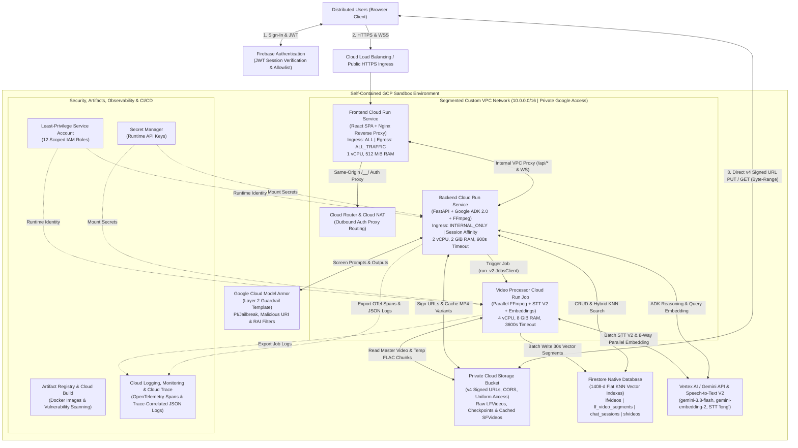
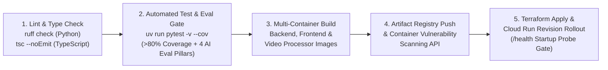

# Cloud Deployment & Infrastructure Architecture (`docs/deployment_and_infra.md`)

This document provides a comprehensive breakdown of the Google Cloud Platform (GCP) infrastructure, Terraform Infrastructure-as-Code (IaC), network segmentation, least-privilege IAM security model, containerization, observability pipeline, and CI/CD deployment workflows for **CLIP_AGENT_OS** (`capstone_be`).

> **Related Reference Documents**:
> - **System Architecture & ADRs**: [`docs/architecture.md`](./architecture.md)
> - **API Routes & Endpoints**: [`docs/routes/README.md`](./routes/README.md)
> - **Unit & Integration Testing**: [`docs/testing.md`](./testing.md)
> - **AI Evaluation Suite**: [`docs/evaluations.md`](./evaluations.md)
> - **Terraform IaC Configuration**: `terraform/main.tf`, `terraform/variables.tf`, `terraform/outputs.tf`, `terraform/versions.tf`
> - **Project Scope & Technical Design Document**: `requirement_docs/clipper_agent_docs/`

---

## 1. Infrastructure Overview & Design Principles

**CLIP_AGENT_OS** is deployed inside a self-contained Google Cloud sandbox environment managed declaratively via **Terraform (`>= 1.5.0`)**. Every compute, storage, database, networking, guardrail, and identity component is provisioned with **scale-to-zero serverless economics**, **strict VPC network segmentation**, and **keyless least-privilege IAM**.

### Core Infrastructure Pillars

| Pillar | Implementation Summary |
| :--- | :--- |
| **1. Zero Public Backend Exposure** | The FastAPI + Google ADK 2.0 backend runs on a Cloud Run Service configured with `INGRESS_TRAFFIC_INTERNAL_ONLY` inside a custom segmented VPC (`10.0.0.0/16`). It is completely unreachable from the public internet and only accepts traffic routed internally from the VPC-attached Frontend Nginx proxy. |
| **2. Non-Blocking Serverless Compute** | Decouples user-facing API/WebSocket traffic (Cloud Run Service with session affinity) from heavy FFmpeg audio extraction, Cloud Speech-to-Text V2 transcription, and 8-way parallel `gemini-embedding-2` video/text indexing (isolated in an on-demand Cloud Run Job with `4 vCPU` and `8 GiB RAM`). |
| **3. Direct-to-Cloud Media Transfer** | Raw long-form video uploads (`PUT`) and inline/exported clip playback (`GET` with HTTP byte-range requests) flow directly between the browser and a private Cloud Storage bucket via short-lived v4 Signed URLs—bypassing API server memory and payload limits. |
| **4. Unified Transactional & KNN Vector Storage** | Uses a single named **Firestore Native** database to store video lifecycle metadata, ADK 2.0 multi-turn session history (`FirestoreSessionService`), saved Reel clips, and `1408`-dimensional multimodal embeddings indexed with composite Flat KNN vector indexes. |
| **5. Defense-in-Depth Security & Keyless IAM** | Enforces Firebase JWT authentication, per-user (`uid`) tenant isolation, Google Cloud Model Armor prompt/output screening, Secret Manager runtime credential injection, and a dedicated least-privilege service account with zero static JSON keys. |

---

## 2. Cloud Topology & Segmented VPC Network Architecture

### 2.1 End-to-End Cloud Infrastructure Diagram



### 2.2 VPC Network Segmentation & Traffic Flow (`terraform/main.tf`)

All container workloads are attached via **Direct VPC Egress** to a custom-mode VPC network (`google_compute_network`) so internal service-to-service communication never traverses the public internet:

| Network Component | Terraform Resource | Configuration | Architectural Purpose |
| :--- | :--- | :--- | :--- |
| **Custom VPC Network** | `google_compute_network` | `auto_create_subnetworks = false` | Isolates all project compute resources from default networks. |
| **Regional Subnet** | `google_compute_subnetwork` | `ip_cidr_range = "10.0.0.0/16"`<br>`private_ip_google_access = true` | Allocates internal IPs for Cloud Run services/jobs and enables **Private Google Access** to reach Google Cloud APIs (`storage`, `firestore`, `aiplatform`, `speech`, `modelarmor`, `secretmanager`, `cloudtrace`) over Google's private backbone. |
| **Internal Firewall Rule** | `google_compute_firewall` | `direction = "INGRESS"`<br>`source_ranges = ["10.0.0.0/16"]`<br>Protocols: `tcp`, `udp`, `icmp` | Permits internal communication between the Frontend Nginx reverse proxy and the internal-only Backend service within the subnet CIDR. |
| **Cloud Router & Cloud NAT** | `google_compute_router`<br>`google_compute_router_nat` | `nat_ip_allocate_option = "AUTO_ONLY"`<br>`ALL_SUBNETWORKS_ALL_IP_RANGES` | Provides managed outbound NAT for the Frontend service (`egress = "ALL_TRAFFIC"`) so Nginx can proxy same-origin Firebase Authentication callbacks (`/__/auth/handler`) while routing `/api/*` traffic privately across the VPC. |

---

## 3. GCP Resource Inventory & Terraform Architecture (`terraform/`)

The `terraform/` directory codifies the entire sandbox stack across **10 logical infrastructure layers**:

```text
terraform/
├── versions.tf               # Terraform >= 1.5.0; hashicorp/google & google-beta (~> 6.0)
├── variables.tf              # Parameterized project, region, storage, DB, model & image inputs
├── main.tf                   # 10-layer declarative GCP resource definitions
├── outputs.tf                # Exported service URLs, bucket/DB identifiers & guardrail IDs
├── terraform.tfvars.example  # Sanitized variable template for environment overrides
└── README.md                 # Quickstart provisioning instructions
```

### 3.1 Layer 1: Enabled Google Cloud APIs (`google_project_service`)

Terraform automatically enables **19 Google Cloud APIs** (`disable_on_destroy = false`) before provisioning downstream resources:

| Category | Service API Identifier | Role in CLIP_AGENT_OS |
| :--- | :--- | :--- |
| **AI, Embeddings & Speech** | `generativelanguage.googleapis.com`<br>`aiplatform.googleapis.com`<br>`speech.googleapis.com`<br>`modelarmor.googleapis.com` | Powers Google ADK 2.0 Gemini reasoning (`orchestrator_agent` & `clip_editor_agent`), `1408`-d multimodal embeddings (`gemini-embedding-2`), word-level audio transcription (Cloud Speech-to-Text V2 `long`), and Layer 2 prompt/response safety screening. |
| **Data & Media Storage** | `firestore.googleapis.com`<br>`storage.googleapis.com` | Provides the named Firestore Native database with composite KNN vector search and the private Cloud Storage bucket for raw long-form videos and rendered short-form clips. |
| **Serverless Compute & Networking** | `run.googleapis.com`<br>`compute.googleapis.com` | Hosts the Frontend and Backend Cloud Run Services, executes the asynchronous Video Processor Cloud Run Job, and manages the custom VPC, subnet, firewall, router, and NAT. |
| **Identity, Auth & Secrets** | `identitytoolkit.googleapis.com`<br>`firebase.googleapis.com`<br>`iam.googleapis.com`<br>`iamcredentials.googleapis.com`<br>`secretmanager.googleapis.com` | Supports Firebase Authentication JWT verification, least-privilege service account bindings, keyless IAM `signBlob` token creation for v4 Signed URLs, and runtime secret injection. |
| **Containers & CI/CD** | `artifactregistry.googleapis.com`<br>`containerscanning.googleapis.com`<br>`cloudbuild.googleapis.com` | Stores versioned Docker images, performs automated container vulnerability scanning, and executes CI/CD build/deployment pipelines. |
| **Observability** | `logging.googleapis.com`<br>`monitoring.googleapis.com`<br>`cloudtrace.googleapis.com` | Captures trace-correlated structured JSON logs, runtime container/application metrics, and distributed OpenTelemetry agent trace waterfalls. |

---

### 3.2 Layer 3: Least-Privilege IAM Service Account (`google_service_account`)

Both the **Backend Cloud Run Service** and the **Video Processor Cloud Run Job** execute under a single dedicated, least-privilege service account (`google_service_account`) rather than the overly permissive default Compute Engine service account.

| Bound IAM Role (`google_project_iam_member`) | Least-Privilege Scope & Justification |
| :--- | :--- |
| `roles/datastore.user` | Read/write access to Firestore collections (`lfvideos`, `lf_video_segments`, `chat_sessions`, `sfvideos`) and execution of composite `find_nearest` KNN vector queries. |
| `roles/storage.objectAdmin` | Read/write/delete access to user-namespaced video objects (`<uid>/lf_videos/...` and `<uid>/sf_videos/...`) and temporary FLAC audio chunks. |
| `roles/iam.serviceAccountTokenCreator` | Allows the Backend container to sign GCS v4 Signed `PUT` and `GET` URLs via the IAM Credentials API (`signBlob`) using keyless Application Default Credentials (no static JSON service account key files on disk). |
| `roles/aiplatform.user` | Invokes Vertex AI / Gemini models for ADK agent orchestration and `gemini-embedding-2` multimodal video/text embedding generation. |
| `roles/speech.client` | Executes parallel Cloud Speech-to-Text V2 `BatchRecognize` jobs (`model="long"`) with word-level timestamp offsets. |
| `roles/modelarmor.user` | Calls the Google Cloud Model Armor API via `ModelArmorPlugin` to sanitize user prompts, tool outputs, and model responses. |
| `roles/secretmanager.secretAccessor` | Allows Cloud Run and `utils/secret_manager.py` to fetch runtime secrets (`GEMINI_API_KEY`) from Secret Manager. |
| `roles/run.developer` | Enables `POST /api/lf_videos/upload/{vid}/complete` (`utils/lf_videos.py`) to trigger executions of the Video Processor Cloud Run Job via `google.cloud.run_v2.JobsClient.run_job`. |
| `roles/iam.serviceAccountUser` | Permits the Backend service to act as the dedicated service account when dispatching Cloud Run Job executions. |
| `roles/cloudtrace.agent` | Exports OpenTelemetry spans from `CloudTraceSpanExporter` (`utils/observability.py`) to Google Cloud Trace. |
| `roles/logging.logWriter` | Writes structured JSON application and analytics logs to Google Cloud Logging. |
| `roles/monitoring.metricWriter` | Reports container and custom runtime metrics to Google Cloud Monitoring. |

---

### 3.3 Layer 4: Secret Manager Integration (`google_secret_manager_secret`)

Sensitive credentials are never hardcoded in source files, Docker images, or Terraform state:
1. **Declarative Secret Shell**: Terraform provisions the `google_secret_manager_secret` resource (`GEMINI_API_KEY`) with automatic multi-region replication (`replication { auto {} }`).
2. **Out-of-Band Secret Payload Upload**: Secret values are populated out-of-band via the `gcloud secrets versions add` CLI so plaintext credentials never enter Git history or `terraform.tfstate`.
3. **Dual Injection Mechanism**:
   - **Cloud Run Native Mounting**: Both the Backend Service and Video Processor Job mount `GEMINI_API_KEY` (`version = "latest"`) directly into container environment variables via `value_source.secret_key_ref`.
   - **Runtime SDK Resolver (`utils/secret_manager.py`)**: Provides `@lru_cache` secret resolution (`get_secret` and `load_secrets_into_env`) using `SecretManagerServiceClient`, gracefully falling back to local `.env` variables during offline development or unit testing.

---

### 3.4 Layer 5: Private Cloud Storage Bucket & Signed URL CORS (`google_storage_bucket`)

The media storage bucket (`var.gcs_bucket_name`) is provisioned as a private regional bucket:
- **Access Controls**:
  - `public_access_prevention = "enforced"` (blocks all public ACLs or allUsers bindings).
  - `uniform_bucket_level_access = true` (enforces IAM-only bucket access).
  - `force_destroy = false` (protects stored video assets from accidental bucket deletion).
- **CORS Policy for Direct Browser Transfers & Byte-Range Streaming**:
  - **Allowed Origins**: `http://localhost:5173`, `http://localhost:8080`, and `var.frontend_url`.
  - **Allowed Methods**: `GET`, `HEAD`, `PUT`, `POST`, `OPTIONS`.
  - **Exposed Headers**: `Content-Type`, `Content-Length`, `Content-Range`, `Range`, `Accept-Ranges`, `ETag` (`max_age_seconds = 3600`).
  - **Why This Matters**: Enables (1) direct browser-to-GCS resumable/chunked binary `PUT` uploads via v4 Signed URLs and (2) HTML5 `<video>` byte-range media fragment seeking (`#t=start,end`) for instant zero-transcode clip previews.

---

### 3.5 Layer 6: Firestore Native Database & 1408-d KNN Vector Indexes

Terraform provisions a dedicated **Firestore Native** database (`google_firestore_database`, `type = "FIRESTORE_NATIVE"`) in the target region alongside composite **Flat KNN Vector Indexes** (`google_firestore_index`) on the `lf_video_segments` collection:

| Index Type | Collection | Indexed Fields (Order / Vector Config) | Query Pattern Supported |
| :--- | :--- | :--- | :--- |
| **Spoken Transcript Vector Index** | `lf_video_segments` | 1. `uid` (`ASCENDING`)<br>2. `video_id` (`ASCENDING`)<br>3. `text_embedding` (`dimension = 1408`, `flat {}`) | **Spoken Dialogue KNN Search**: Pre-filters by authenticated user (`uid`) and optional pinned tape (`video_id`), then ranks segments by Cosine similarity on `text_embedding`. |
| **Multimodal Video Vector Index** | `lf_video_segments` | 1. `uid` (`ASCENDING`)<br>2. `video_id` (`ASCENDING`)<br>3. `video_embedding` (`dimension = 1408`, `flat {}`) | **Visual Scene KNN Search**: Pre-filters by authenticated user (`uid`) and optional pinned tape (`video_id`), then ranks segments by Cosine similarity on `video_embedding`. |

> [!NOTE]
> When searching across **all** user tapes (`ALL_VAULT_TAPES`) or listing user-owned sessions/clips (`chat_sessions` sorted by `uid ASC, updated_at DESC`; `sfvideos` sorted by `uid ASC, created_at DESC`), Firestore utilizes corresponding composite indexes scoped by `uid` to guarantee zero-trust tenant isolation on every query.

---

### 3.6 Layer 7: Google Cloud Model Armor Guardrail Template (`google_model_armor_template`)

To enforce **Layer 2 (Platform-Level) AI Safety Guardrails**, Terraform provisions a regional `google_model_armor_template` resource (`provider = google-beta`) and passes its full resource ID into the Backend service via `MODEL_ARMOR_TEMPLATE_NAME`:

| Filter Category | Setting Block | Enforcement / Confidence Level | Threat Mitigated |
| :--- | :--- | :--- | :--- |
| **Prompt Injection & Jailbreak** | `pi_and_jailbreak_filter_settings` | `ENABLED` (`LOW_AND_ABOVE`) | Blocks instruction-override attacks (`Ignore previous instructions...`), `DAN` jailbreaks, and system-prompt extraction attempts at the edge before the LLM is called. |
| **Malicious URI Detection** | `malicious_uri_filter_settings` | `ENABLED` | Blocks phishing links, malware URLs, and untrusted external URI payloads in prompts and tool outputs. |
| **Responsible AI (RAI) — Dangerous** | `rai_settings.rai_filters` (`DANGEROUS`) | `MEDIUM_AND_ABOVE` | Screens for dangerous content, self-harm, or illegal acts. |
| **Responsible AI (RAI) — Hate Speech** | `rai_settings.rai_filters` (`HATE_SPEECH`) | `MEDIUM_AND_ABOVE` | Screens for hate speech and discriminatory language. |
| **Responsible AI (RAI) — Harassment** | `rai_settings.rai_filters` (`HARASSMENT`) | `MEDIUM_AND_ABOVE` | Screens for targeted harassment, bullying, or abuse. |
| **Responsible AI (RAI) — Sexually Explicit** | `rai_settings.rai_filters` (`SEXUALLY_EXPLICIT`) | `MEDIUM_AND_ABOVE` | Screens for sexually explicit content in prompts or generated responses. |

At runtime, `agent/agent.py` (`_build_plugins()`) attaches ADK's `ModelArmorPlugin` to `clipping_app`, intercepting `before_model_callback`, `after_model_callback`, and `after_tool_callback`.

---

### 3.7 Layers 8, 9 & 10: Artifact Registry, Cloud Run Services & Cloud Run Job

All three application containers are stored in a regional **Artifact Registry** Docker repository (`google_artifact_registry_repository`, `format = "DOCKER"`) and deployed as serverless Cloud Run v2 resources:

| Specification | Frontend Service (`google_cloud_run_v2_service`) | Backend Service (`google_cloud_run_v2_service`) | Video Processor Job (`google_cloud_run_v2_job`) |
| :--- | :--- | :--- | :--- |
| **Primary Responsibility** | Serves React/TypeScript SPA static bundle; proxies `/api/*` & WebSocket traffic over VPC to Backend; proxies `/__/` to Firebase Auth | FastAPI REST API, bidirectional WebSocket ADK 2.0 multi-agent streaming (`WS /api/chat/stream`), and on-demand FFmpeg clip export | Asynchronous long-form video indexing: parallel FFmpeg `16kHz` FLAC chunking + Speech-to-Text V2 (`long`) + 8-way parallel 30s `gemini-embedding-2` indexing |
| **Ingress Policy** | `INGRESS_TRAFFIC_ALL` (Public HTTPS) | `INGRESS_TRAFFIC_INTERNAL_ONLY` (Private VPC only) | N/A (Triggered via Cloud Run Jobs API) |
| **VPC Egress Policy** | Direct VPC (`ALL_TRAFFIC` via Cloud NAT) | Direct VPC (`PRIVATE_RANGES_ONLY`) | Direct VPC (`PRIVATE_RANGES_ONLY`) |
| **CPU / Memory Limits** | `1 vCPU` / `512 MiB` | `2 vCPU` / `2 GiB` | `4 vCPU` / `8 GiB` |
| **Timeout / Retries** | Default HTTP timeout (`900s` Nginx proxy timeout) | `900s` (supports long-lived WebSocket sessions & FFmpeg exports) | `3600s` (`1 hour`), `max_retries = 1` |
| **Session Affinity** | `false` | `true` (pins stateful WebSocket connections) | N/A |
| **Startup Probe** | `GET /health` on `:8080` (`delay=2s, period=5s, threshold=5`) | `GET /health` on `:8080` (`delay=3s, period=5s, threshold=6`) | N/A (Batch CLI execution) |
| **Service Account** | Default runtime identity (no GCP data access) | Dedicated Least-Privilege Backend SA | Dedicated Least-Privilege Backend SA |

---

## 4. Containerization & Runtime Configuration

### 4.1 Container Build Specifications (`Dockerfile`)

1. **Backend Container (`capstone_be/Dockerfile`)**:
   - **Base Image**: `ghcr.io/astral-sh/uv:python3.14-bookworm-slim`.
   - **System Media & Subtitle Dependencies**: Installs `ffmpeg`, `fontconfig`, `fonts-dejavu-core`, and `ca-certificates` (`fc-cache -f -v`) so FFmpeg's `libass` filter can render burned-in active-word yellow (`{\c&H0000F0FF&}`) `.ass` karaoke subtitles in `16:9` and `9:16` exports.
   - **Dependency Caching**: Uses `UV_COMPILE_BYTECODE=1` and `UV_LINK_MODE=copy`, running `uv sync --no-dev --no-install-project` before copying application code to maximize Docker layer caching.
   - **WebSocket Keep-Alive Entrypoint**:
     ```dockerfile
     CMD ["uv", "run", "uvicorn", "main:app", "--host", "0.0.0.0", "--port", "8080", "--ws-ping-interval", "20", "--ws-ping-timeout", "60"]
     ```
2. **Video Processor Job Container (`capstone_video_processor/Dockerfile`)**:
   - **Base Image**: `python:3.14-slim`.
   - **Entrypoint**: `ENTRYPOINT ["python", "main.py"]`. When `POST /api/lf_videos/upload/{vid}/complete` invokes `run_v2.JobsClient.run_job`, it passes container argument overrides `["--video-id", "<vid>", "--uid", "<uid>"]`.
   - **Idempotent Checkpointing**: Stores `transcript_checkpoint.json` in GCS after Speech-to-Text V2 finishes so any job retry (`max_retries = 1`) skips audio transcription and resumes directly at embedding/Firestore indexing.
3. **Frontend Container (`capstone-fe/Dockerfile` & `nginx.conf`)**:
   - **Stage 1 (`node:22-bookworm-slim`)**: Injects `VITE_FIREBASE_*` and `VITE_BACKEND_BASE_URL` build arguments and compiles the production Vite + React + TypeScript bundle (`npm run build`).
   - **Stage 2 (`nginx:stable-alpine`)**: Serves static assets on port `8080` with `gzip` compression and three specialized location blocks:
     - `location /__/`: Reverse-proxies Firebase Authentication redirect handlers (`/__/auth/handler`) so `signInWithRedirect` remains same-origin.
     - `location /api/`: Reverse-proxies all REST (`/api/*`) and WebSocket (`/api/chat/stream`) requests privately over the VPC to the internal Backend Cloud Run URL with `Upgrade` / `Connection` headers and `900s` timeouts.
     - `location = /health`: Returns `200 {"status":"ok"}` for Cloud Run startup probes.

### 4.2 Environment Variable Reference

All runtime settings are injected into the containers by Terraform (`terraform/main.tf`) or loaded locally from `.env`:

| Environment Variable | Consumed By | Description |
| :--- | :---: | :--- |
| `GCP_PROJECT_ID` | Backend, Processor | Target Google Cloud project identifier. |
| `GCP_REGION` | Backend, Processor | Primary deployment region (e.g., `us-central1`). |
| `FIRESTORE_DB_NAME` | Backend, Processor | Named Firestore Native database identifier. |
| `GCS_ROOT_BUCKET_NAME` | Backend, Processor | Private Cloud Storage bucket name for raw videos, audio chunks, and exported clips. |
| `LFVIDEO_COLLECTION_NAME` | Backend, Processor | Firestore collection for long-form video records (`lfvideos`). |
| `LFVIDEO_SEGMENT_COLLECTION_NAME` | Backend, Processor | Firestore collection for 30-second multimodal vector segments (`lf_video_segments`). |
| `CHAT_SESSION_COLLECTION_NAME` | Backend | Firestore collection for ADK 2.0 `FirestoreSessionService` sessions (`chat_sessions`). |
| `SFVIDEO_COLLECTION_NAME` | Backend | Firestore collection for saved short-form Reel clips (`sfvideos`). |
| `ALLOWLIST_COLLECTION_NAME` | Backend | Firestore collection for the Google SSO email allowlist (`app_config`). |
| `ALLOWLIST_DOC_ID` | Backend | Firestore document ID inside `ALLOWLIST_COLLECTION_NAME` storing `{"enabled": true, "emails": [...]}` (`allowlist`). |
| `VIDEO_PROCESSOR_JOB_NAME` | Backend | Name of the Cloud Run Job triggered upon upload completion. |
| `SIGNING_SERVICE_ACCOUNT_EMAIL` | Backend | Service account email used for keyless IAM `signBlob` v4 Signed URL generation on Cloud Run. |
| `MODEL_ARMOR_TEMPLATE_NAME` | Backend | Full resource path (`projects/<PROJECT>/locations/<REGION>/templates/<TEMPLATE>`) for `ModelArmorPlugin`. |
| `ORCHESTRATOR_MODEL_NAME` | Backend | Gemini model identifier for the root `orchestrator_agent` (default `gemini-3.8-flash`). |
| `CLIPPER_SUBAGENT_MODEL_NAME` | Backend | Gemini model identifier for the single-turn `clip_editor_agent` (default `gemini-3.8-flash`). |
| `EMBEDDING_MODEL_NAME` | Backend, Processor | Multimodal embedding model identifier (`gemini-embedding-2` at `1408` dimensions). |
| `FRONTEND_URL` | Backend | Comma-separated list of allowed CORS origins (`http://localhost:5173,http://localhost:8080,<PUBLIC_FRONTEND_URL>`). |
| `GEMINI_API_KEY` | Backend, Processor | API key mounted at runtime from Google Cloud Secret Manager (`secret_key_ref`). |

---

## 5. Observability, Distributed Tracing & Operational Telemetry

Observability is implemented in `utils/observability.py` and initialized at application startup (`main.py` -> `setup_observability("clipper-agent-backend")`).

### 5.1 OpenTelemetry & Google Cloud Trace Integration
- **Automatic GCP Resource Detection**: Uses `GoogleCloudResourceDetector(raise_on_error=False)` and `OTELResourceDetector()` to attach Cloud Run service, revision, instance, and region metadata to every exported trace span without failing when run locally.
- **Cloud Trace Exporter**: Attaches `BatchSpanProcessor(CloudTraceSpanExporter(...))` to the global OpenTelemetry `TracerProvider`.
- **End-to-End Span Hierarchy**:
  - **Application Spans**: Custom spans wrap each WebSocket chat turn (`websocket.chat_turn`), Reel export request (`sf_videos.download`), and FFmpeg subprocess execution (`ffmpeg.render_variant`).
  - **ADK 2.0 Internal Spans**: Automatically captures child spans for `orchestrator_agent` invocations, `ModelArmorPlugin` callbacks, `search_video_segments` KNN queries, sub-agent delegations to `clip_editor_agent`, `get_expanded_segment_window` fetches, and `propose_clip_candidate` executions.

### 5.2 Trace-Correlated Structured JSON Logging (`CloudLoggingJsonFormatter`)
When running on Cloud Run (`K_SERVICE` is set) or when `JSON_LOGS=true`, `CloudLoggingJsonFormatter` serializes every Python log record as single-line JSON and injects the active OpenTelemetry trace context:
```json
{
  "severity": "INFO",
  "message": "[SF_VIDEO_EXPORT] {\"sf_id\": \"...\", \"variant_key\": \"9:16_crop__1080p__subs_on\", \"cache_hit\": true}",
  "logger": "clipper.analytics",
  "timestamp": "2026-10-15T16:00:00.000000+00:00",
  "logging.googleapis.com/trace": "projects/<GCP_PROJECT_ID>/traces/<32_CHAR_HEX_TRACE_ID>",
  "logging.googleapis.com/spanId": "<16_CHAR_HEX_SPAN_ID>",
  "logging.googleapis.com/trace_sampled": true,
  "event_type": "SF_VIDEO_EXPORT",
  "telemetry": {
    "event_type": "SF_VIDEO_EXPORT",
    "sf_id": "...",
    "variant_key": "9:16_crop__1080p__subs_on",
    "cache_hit": true
  }
}
```
This allows engineers to click any log entry in **Google Cloud Logging** and jump directly to the corresponding multi-agent waterfall in **Google Cloud Trace**.

### 5.3 Structured Product & Compute Analytics (`log_analytics_event`)
The backend emits structured telemetry events (`logger="clipper.analytics"`) for log-based metrics and operational dashboards:
1. **`AGENT_TURN_METRICS`** (`routes/chat/stream.py`): Records `session_id`, `uid`, `duration_ms`, `selected_video_count`, and `interrupted` (`true`/`false`) for every conversational turn.
2. **`CLIP_CANDIDATE_SAVED`** (`routes/sf_videos/save.py`): Tracks human-in-the-loop conversion from AI-proposed `ClipCandidate` cards to saved Reel items (`sf_id`, `video_id`, `candidate_id`, `duration_sec`).
3. **`SF_VIDEO_SUBTITLES_UPDATED`** (`routes/sf_videos/manage.py`): Tracks subtitle editor usage (`mode = "SIMPLE_TEXT" | "WORD_TIMING"`, `word_count`, and `invalidated_cached_variants`).
4. **`SF_VIDEO_EXPORT`** (`routes/sf_videos/manage.py`): Tracks `variant_key`, `aspect_ratio`, `resolution`, `subtitles`, `cache_hit` (`true`/`false`), and `render_duration_ms` to quantify FFmpeg compute savings from `rendered_variants` caching.

---

## 6. Local Development, Terraform Provisioning & CI/CD Pipeline

### 6.1 Local Development Setup (Keyless Service Account Impersonation)

In accordance with Google Cloud best practices, **no static service account JSON keys** are downloaded to developer machines. Developers authenticate locally by impersonating the dedicated Backend Service Account via Application Default Credentials (ADC):

```bash
# 1. Authenticate with ADC using Service Account impersonation
gcloud auth application-default login \
  --impersonate-service-account="<BACKEND_SERVICE_ACCOUNT_EMAIL>"

# 2. Configure capstone_be/.env with your environment variables, then start FastAPI
cd capstone_be
uv run uvicorn main:app --reload --port 8000

# 3. Start the React/TypeScript frontend in a separate terminal (proxies /api & WS to :8000)
cd capstone-fe
npm run dev
```

> [!TIP]
> **How Signed URLs Work Locally vs. Cloud Run (`utils/lf_videos.py`)**:
> When running on Cloud Run (`SIGNING_SERVICE_ACCOUNT_EMAIL` set) or via ADC impersonation, `generate_v4_upload_signed_url` and `generate_v4_read_signed_url` automatically refresh temporary OAuth2 access tokens and pass `service_account_email` + `access_token` to `blob.generate_signed_url(version="v4")`, delegating cryptographic signing to the IAM Credentials `signBlob` API without requiring a local private key file.

---

### 6.2 Step-by-Step Manual Deployment & Terraform Runbook

#### Step 1: Build & Push Container Images to Artifact Registry
```bash
# Configure Docker authentication for Artifact Registry
gcloud auth configure-docker <GCP_REGION>-docker.pkg.dev

# 1. Build & push FastAPI Backend image
docker build -t <GCP_REGION>-docker.pkg.dev/<GCP_PROJECT_ID>/<ARTIFACT_REPO>/<BACKEND_IMAGE>:latest ./capstone_be
docker push <GCP_REGION>-docker.pkg.dev/<GCP_PROJECT_ID>/<ARTIFACT_REPO>/<BACKEND_IMAGE>:latest

# 2. Build & push Video Processor Cloud Run Job image
docker build -t <GCP_REGION>-docker.pkg.dev/<GCP_PROJECT_ID>/<ARTIFACT_REPO>/<PROCESSOR_IMAGE>:latest ./capstone_video_processor
docker push <GCP_REGION>-docker.pkg.dev/<GCP_PROJECT_ID>/<ARTIFACT_REPO>/<PROCESSOR_IMAGE>:latest

# 3. Build & push React + Nginx Frontend image
docker build -t <GCP_REGION>-docker.pkg.dev/<GCP_PROJECT_ID>/<ARTIFACT_REPO>/<FRONTEND_IMAGE>:latest ./capstone-fe
docker push <GCP_REGION>-docker.pkg.dev/<GCP_PROJECT_ID>/<ARTIFACT_REPO>/<FRONTEND_IMAGE>:latest
```

#### Step 2: Provision & Reconcile Infrastructure via Terraform
```bash
cd terraform

# Copy example variable template and populate environment-specific values
cp terraform.tfvars.example terraform.tfvars

# Initialize providers, validate syntax, and review the execution plan
terraform init
terraform validate
terraform plan -var-file="terraform.tfvars"

# Apply the 10-layer GCP infrastructure stack
terraform apply -var-file="terraform.tfvars"
```

#### Step 3: Populate `GEMINI_API_KEY` in Secret Manager (One-Time Out-of-Band Step)
```bash
printf "YOUR_GEMINI_API_KEY" | gcloud secrets versions add GEMINI_API_KEY \
  --data-file=- \
  --project="<GCP_PROJECT_ID>"
```

#### Step 4: Verify Terraform Outputs & Service Health
```bash
# Inspect provisioned URLs and resource identifiers
terraform output

# Verify deployed service health via authenticated Cloud Run proxy
gcloud run services proxy <FRONTEND_SERVICE_NAME> \
  --port=8080 \
  --region="<GCP_REGION>" \
  --project="<GCP_PROJECT_ID>"
```

---

### 6.3 Automated CI/CD Pipeline (`cloudbuild.yaml`)

For automated staging and production rollouts, the **Google Cloud Build** pipeline executes a 5-stage verification and deployment workflow:



1. **Stage 1 — Linting & Static Type Analysis**:
   - Runs `ruff check` across `capstone_be/` and `capstone_video_processor/` and `tsc --noEmit` across `capstone-fe/`.
2. **Stage 2 — Unit, Integration & AI Evaluation Quality Gate**:
   - Executes `uv run pytest -v --cov` in `capstone_be/`, enforcing both the **`>= 80%` code coverage gate** (`tests/`) and the **4 North Star AI Evaluation gates** (`evals/`: `100%` Recall@5, `100%` Boundary Hygiene, `100%` 2-Layer Guardrail Block Rate with `0` tool calls, and Rubric Judge pass rate).
3. **Stage 3 — Container Image Compilation**:
   - Builds version-tagged Docker images (`$SHORT_SHA` and `:latest`) for the Backend Service, Frontend Service, and Video Processor Job.
4. **Stage 4 — Artifact Registry Push & Vulnerability Scanning**:
   - Pushes images to the regional Artifact Registry repository where `containerscanning.googleapis.com` automatically inspects OS and Python/Node package layers for CVEs.
5. **Stage 5 — Infrastructure Reconciliation & Zero-Downtime Rollout**:
   - Runs `terraform apply -auto-approve` to reconcile Firestore KNN vector indexes, GCS CORS policies, Model Armor templates, IAM bindings, and Cloud Run revisions.
   - Cloud Run verifies `/health` startup probes on the new container revisions before shifting traffic, automatically rolling back on health-check failure.
