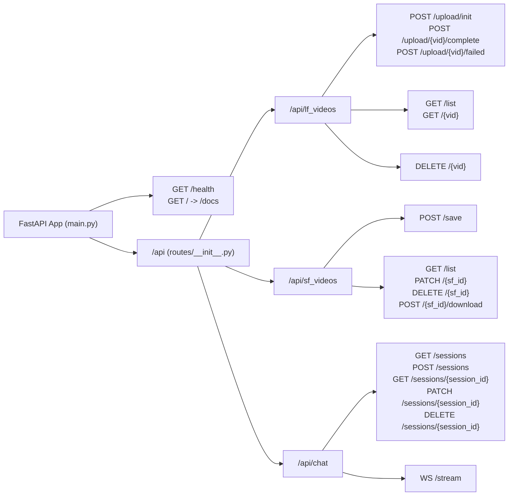

# API Routes & Endpoints Reference (`docs/routes/`)

This directory documents all HTTP REST and WebSocket endpoints exposed by the **CLIP_AGENT_OS** FastAPI backend (`main.py` and `routes/`).

---

## 1. Documentation Split by Router Group

| Document | Router Prefix | Source Files | Summary |
| :--- | :--- | :--- | :--- |
| **[`lf_videos.md`](./lf_videos.md)** | `/api/lf_videos` | `routes/lf_videos/upload.py` `routes/lf_videos/read.py` `routes/lf_videos/delete.py` | **UPLOAD & VAULT Workflows**: Direct-to-GCS resumable upload initialization, completion/Cloud Run Job trigger, failure reporting, Vault listing, and cascading deletion. |
| **[`sf_videos.md`](./sf_videos.md)** | `/api/sf_videos` | `routes/sf_videos/save.py` `routes/sf_videos/manage.py` | **REEL Workflow**: Human-in-the-loop clip saving (with idempotency), saved clip listing, dual-mode subtitle editing & cache invalidation, deletion, and on-demand FFmpeg variant export. |
| **[`chat_sessions.md`](./chat_sessions.md)** | `/api/chat/sessions` | `routes/chat/chat_sessions.py` | **CHAT Sidebar & History REST API**: Listing lightweight session summaries, creating sessions, reconstructing full UI message/trace/clip history from ADK events, updating pinned videos/titles, and deleting threads. |
| **[`chat_stream.md`](./chat_stream.md)** | `/api/chat/stream` | `routes/chat/stream.py` | **CHAT Bidirectional WebSocket Protocol**: First-frame JWT authentication handshake, lazy draft session creation, real-time SSE token/thought/trace/clip streaming, and live mid-turn `INTERRUPT` / `ADD_CONTEXT` steering. |

---

## 2. Authentication & Security Model (`utils/auth.py`)

All `/api/*` endpoints enforce Firebase Authentication JWT verification against `GCP_PROJECT_ID` using `google.oauth2.id_token.verify_firebase_token`:

1. **HTTP REST Endpoints (`Depends(get_current_user)`)**:
   - Expects standard header: `Authorization: Bearer <firebase_id_token>`.
   - Extracts `uid` (`sub` or `user_id`), `email`, and `claims` into a validated `UserInfo` model.
   - Returns `401 Unauthorized` (`WWW-Authenticate: Bearer`) if the token is missing, expired, or invalid.
2. **WebSocket Endpoint (`/api/chat/stream`)**:
   - Uses a **First-Message Authentication Handshake**: after connecting, the client must send `{"type": "AUTH", "token": "<firebase_id_token>"}` within `10.0` seconds.
   - Closes with WebSocket code `1008 (WS_1008_POLICY_VIOLATION)` if authentication times out or fails.
3. **Strict Tenant Ownership Isolation**:
   - Every Firestore query and document lookup (`get_user_video_doc`, `get_user_sf_video_doc`, `get_verified_adk_session`, `validate_owned_video_ids`) verifies `doc.uid == user.uid`, returning `403 Forbidden` or `404 Not Found` on cross-tenant access attempts.

---

## 3. System & Health Endpoints (`main.py`)

| Method | Path | Auth | Status | Description |
| :---: | :--- | :---: | :---: | :--- |
| `GET` | `/` | None | `307` | Redirects root requests to the interactive OpenAPI Swagger UI at `/docs`. |
| `GET` | `/health` | None | `200` | Liveness/readiness probe for Cloud Run (`{"status": "ok"}`). |

---

## 4. Complete Endpoint Map

