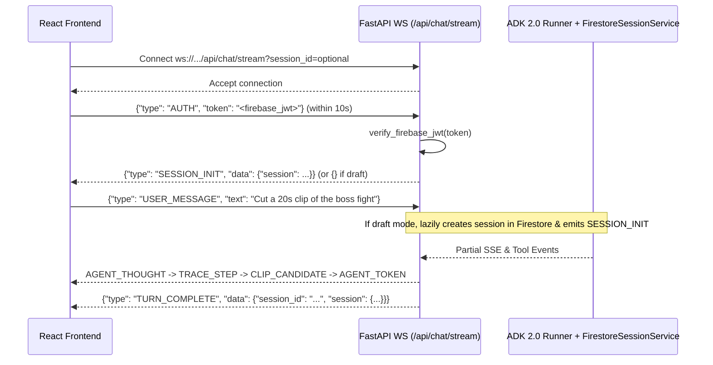

# Chat Bidirectional WebSocket Streaming (`WS /api/chat/stream`)

**Source Files**:
- `routes/chat/stream.py`
- Agent & Tools: `agent/agent.py`, `agent/tools/`
- Models: `models/chat.py` (`WSClientMessage`, `WSServerMessage`)

The `/api/chat/stream` WebSocket endpoint drives real-time conversational RAG and short-form video clipping with Google ADK 2.0 (`Runner` with `StreamingMode.SSE`), supporting live thought/tool trace streaming, inline `ClipCandidate` card emission, and mid-turn cancellation/steering.

---

## 1. Connection & Handshake Sequence



### First-Message `AUTH` Handshake
1. Upon `websocket.accept()`, the server waits up to **`10.0` seconds** for the first JSON message.
2. The first message **must** be `{"type": "AUTH", "token": "<firebase_jwt>", "session_id": "<optional_id>"}`.
3. If missing, invalid, or timed out, the server sends an `ERROR` frame and closes with code **`1008 (WS_1008_POLICY_VIOLATION)`**.
4. Once authenticated, the server emits `SESSION_INIT` containing `{ "session": ChatSessionSummary }` if resuming an existing `session_id`, or `{}` if starting in clean **draft mode**.

---

## 2. Inbound Client Frames (`WSClientMessage`)

All client-to-server frames are validated against `WSClientMessage`:

```json
{
  "type": "AUTH | USER_MESSAGE | INTERRUPT | ADD_CONTEXT | SET_VIDEOS",
  "token": "optional-jwt-for-AUTH",
  "session_id": "optional-session-id",
  "text": "optional-message-or-steering-text",
  "selected_video_ids": ["optional-video-id-list"]
}
```

| Frame `type` | Behavior |
| :--- | :--- |
| **`AUTH`** | First frame only; authenticates user via `verify_firebase_jwt` and optionally binds `session_id`. |
| **`USER_MESSAGE`** | Cancels any active in-flight turn (`_stop_active_turn()`), validates `selected_video_ids` if provided, **lazily creates the Firestore session on the first message** (auto-titling from the first `45` characters of the prompt), and launches `_run_agent_turn` as an async task. |
| **`INTERRUPT`** | Signals `active_abort_signal.set()`, cancels the running agent turn task, commits any uncommitted partial assistant text to Firestore with `last_turn_interrupted: True`, and emits `TURN_INTERRUPTED`. |
| **`ADD_CONTEXT`** | Halts the active turn via `_stop_active_turn()`, emits `CONTEXT_ADDED`, and immediately starts a new turn prefixed with `[USER ADDED CONTEXT / STEERING]: <text>`. |
| **`SET_VIDEOS`** | Validates `selected_video_ids` against the user's `SUCCESSFUL` Vault videos, persists the updated list into `session.state["selected_video_ids"]`, and emits `VIDEOS_UPDATED`. |

---

## 3. Outbound Server Frames (`WSServerMessage`)

All server-to-client frames follow the `WSServerMessage` envelope:

```json
{
  "type": "<ServerMessageType>",
  "data": { ... }
}
```

| Frame `type` | `data` Payload Structure | When Emitted |
| :--- | :--- | :--- |
| **`SESSION_INIT`** | `{"session": ChatSessionSummary}` or `{}` | After `AUTH` handshake, and again when a draft session is lazily persisted on the first `USER_MESSAGE`. |
| **`AGENT_THOUGHT`** | `{"delta": "<text>", "branch": "<subagent_or_null>"}` | Real-time streaming reasoning token deltas (`part.thought == True` on partial SSE events). |
| **`TRACE_STEP`** | `{"step": AgentTraceStep}` | Committed reasoning step (`THOUGHT`), tool invocation (`TOOL_CALL`), or tool completion (`TOOL_RESULT`) for the live **`AGENT TRACE`** drawer. |
| **`CLIP_CANDIDATE`** | `{"candidate": ClipCandidate}` | Emitted immediately when `clip_editor_agent` completes `propose_clip_candidate`, rendering the interactive video preview card in Chat. |
| **`AGENT_TOKEN`** | `{"delta": "<text>"}` | Real-time visible assistant response text deltas from the root `orchestrator_agent` (`not ev.branch`). |
| **`TURN_COMPLETE`** | `{"session_id": "<id>", "session": ChatSessionSummary}` | Emitted when the agent turn finishes normally; also logs `AGENT_TURN_METRICS` (`duration_ms`) and records a `websocket.chat_turn` OpenTelemetry span. |
| **`TURN_INTERRUPTED`** | `{"session_id": "<id>"}` | Acknowledge frame after processing a client `INTERRUPT` command. |
| **`CONTEXT_ADDED`** | `{"session_id": "<id>", "text": "<steering_text>"}` | Acknowledge frame after processing a client `ADD_CONTEXT` steering command. |
| **`VIDEOS_UPDATED`** | `{"selected_video_ids": ["..."]}` | Acknowledge frame after updating the Tape Selector scope via `SET_VIDEOS`. |
| **`ERROR`** | `{"message": "<error_description>"}` | Sent on invalid message payloads, unowned video pinning attempts, or runtime agent errors. |
