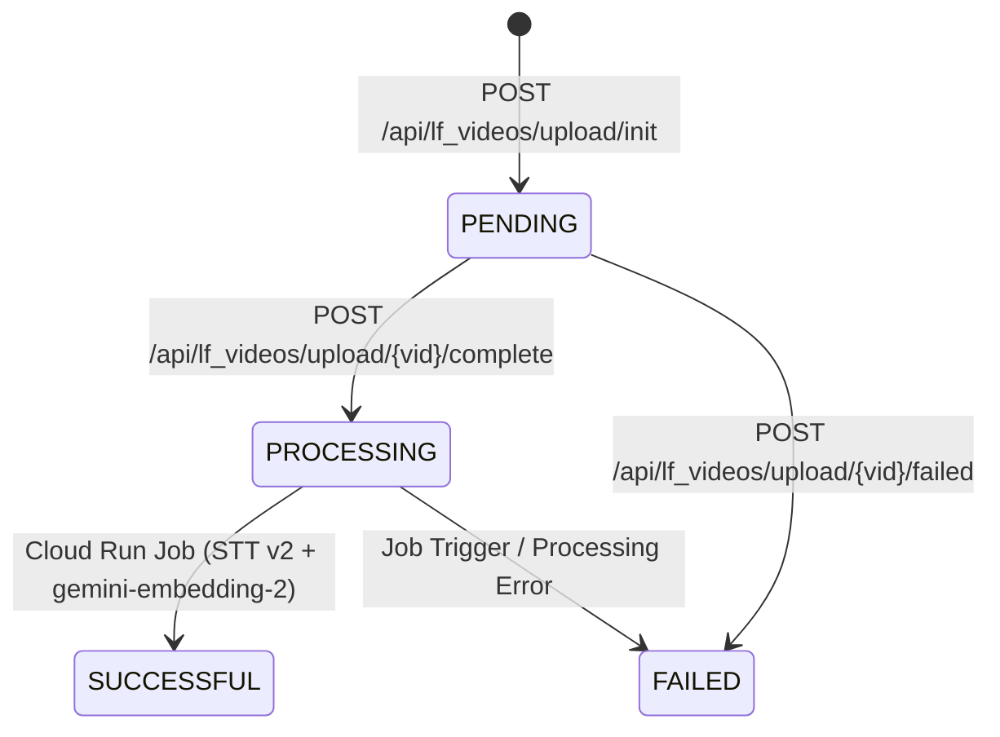

# Long-Form Video Routes (`/api/lf_videos`)

**Source Files**:
- `routes/lf_videos/__init__.py`
- `routes/lf_videos/upload.py`
- `routes/lf_videos/read.py`
- `routes/lf_videos/delete.py`
- Helpers & Models: `utils/lf_videos.py`, `models/lf_videos.py`

These endpoints power the **`UPLOAD`** (Direct-to-GCS Resumable Ingestion & Cloud Run Job Trigger) and **`VAULT`** (Tape Library Management & Cascading Deletion) workflows.

---

## 1. State Machine (`LFVideo.status`)



---

## 2. Upload Lifecycle Endpoints (`routes/lf_videos/upload.py`)

### `POST /api/lf_videos/upload/init`
Initializes a direct-to-GCS resumable video upload session and creates a `PENDING` tracking record in Firestore's `lfvideos` collection.

- **Auth**: `Bearer <Firebase-JWT>`
- **Response Code**: `201 Created`
- **Allowed MIME Types (`ALLOWED_VIDEO_TYPES`)**:
  - `video/mp4` (`mp4`), `video/webm` (`webm`), `video/quicktime` (`mov`), `video/x-msvideo` (`avi`), `video/x-matroska` (`mkv`)

#### Request Body (`LFUploadRequest`)
```json
{
  "filename": "elden_ring_stream_vod.mp4",
  "content_type": "video/mp4",
  "file_size_bytes": 524288000,
  "duration_seconds": 3600
}
```

#### Response Body (`LFUploadResponse`)
```json
{
  "video_id": "8f9d2a1b3c4e5f6a",
  "upload_url": "https://storage.googleapis.com/upload/storage/v1/b/<bucket>/o?uploadType=resumable&upload_id=...",
  "gcs_uri": "gs://<bucket>/<uid>/lf_videos/8f9d2a1b3c4e5f6a/original.mp4",
  "blob_path": "<uid>/lf_videos/8f9d2a1b3c4e5f6a/original.mp4"
}
```

#### Error Responses
| Status | Condition | Behavior |
| :---: | :--- | :--- |
| `415` | `content_type` not in `ALLOWED_VIDEO_TYPES` | Rejects before touching Firestore or GCS. |
| `500` | Firestore connection or `.set()` error | Returns database error detail. |
| `502` | GCS `create_resumable_upload_session` fails | Automatically deletes the pre-created `PENDING` Firestore document (`doc_ref.delete()`) to prevent orphaned records. |

---

### `POST /api/lf_videos/upload/{vid}/complete`
Called by the React frontend once the direct-to-GCS binary upload finishes. Verifies the object exists in GCS, transitions the document to `status = "PROCESSING"`, and triggers the asynchronous **Cloud Run Video Processor Job** (`trigger_video_processor_job`).

- **Auth**: `Bearer <Firebase-JWT>` (must own `vid`)
- **Path Parameter**: `vid` (`str`) — Firestore document ID of the long-form video.
- **Response Code**: `200 OK`
- **Response Body**: Updated `LFVideo` object (`status: "PROCESSING"`, `file_size_bytes` synced from `blob.size`).

#### Error Responses
| Status | Condition | Behavior |
| :---: | :--- | :--- |
| `400` | `blob.exists()` is `False` in GCS | Resumable upload was not finalized; status remains unchanged. |
| `403` / `404` | Video owned by another user or does not exist | Enforced by `get_user_video_doc(vid, user.uid)`. |
| `500` | Cloud Run Job trigger (`run_jobs_client.run_job`) fails | Updates Firestore record to `status = "FAILED"` with `error_msg` before raising `500`. |
| `502` | GCS verification RPC fails | Returns `502 Bad Gateway`. |

---

### `POST /api/lf_videos/upload/{vid}/failed`
Marks an in-progress upload as `FAILED` if the browser upload is aborted or encounters a network error.

- **Auth**: `Bearer <Firebase-JWT>` (must own `vid`)
- **Response Code**: `200 OK`
- **Request Body (`LFUploadFailedRequest`)**:
  ```json
  {
    "error_msg": "Upload failed or was aborted by client."
  }
  ```
- **Response Body**: Updated `LFVideo` (`status: "FAILED"`, `is_complete: false`).
- **Error Responses**:
  - `409 Conflict`: Raised if the video already has `is_complete == True` or `status == "SUCCESSFUL"`, preventing accidental overwrite of a completed video.

---

## 3. Vault Read Endpoints (`routes/lf_videos/read.py`)

### `GET /api/lf_videos/list`
Returns all `LFVideo` documents belonging to the authenticated user, sorted newest-first (`created_at` descending in memory).

- **Auth**: `Bearer <Firebase-JWT>`
- **Response Code**: `200 OK`
- **Response Body**: `list[LFVideo]`

---

### `GET /api/lf_videos/{vid}`
Fetches a single `LFVideo` document by ID after verifying ownership.

- **Auth**: `Bearer <Firebase-JWT>`
- **Response Code**: `200 OK`
- **Response Body**: `LFVideo`
- **Error Responses**: `404 Not Found` (missing ID), `403 Forbidden` (wrong `uid`).

---

## 4. Cascading Delete Endpoint (`routes/lf_videos/delete.py`)

### `DELETE /api/lf_videos/{vid}`
Performs a three-stage cascading cleanup of a long-form video across GCS and Firestore:
1. **GCS Cleanup**: Lists and batch-deletes all blobs under `<uid>/lf_videos/<vid>/` (raw video + any extracted segment artifacts).
2. **Vector Segment Cleanup (`lf_video_segments`)**: Queries all 30-second RAG segment documents where `video_id == vid` and deletes them via Firestore `WriteBatch` in chunks of `400` operations per commit.
3. **Parent Document Cleanup (`lfvideos`)**: Deletes the `lfvideos/{vid}` document.

- **Auth**: `Bearer <Firebase-JWT>` (must own `vid`)
- **Response Code**: `204 No Content`
- **Error Responses**: `403 Forbidden`, `404 Not Found`, `502 Bad Gateway` (GCS deletion error), `500 Internal Server Error` (Firestore batch/doc deletion error).
